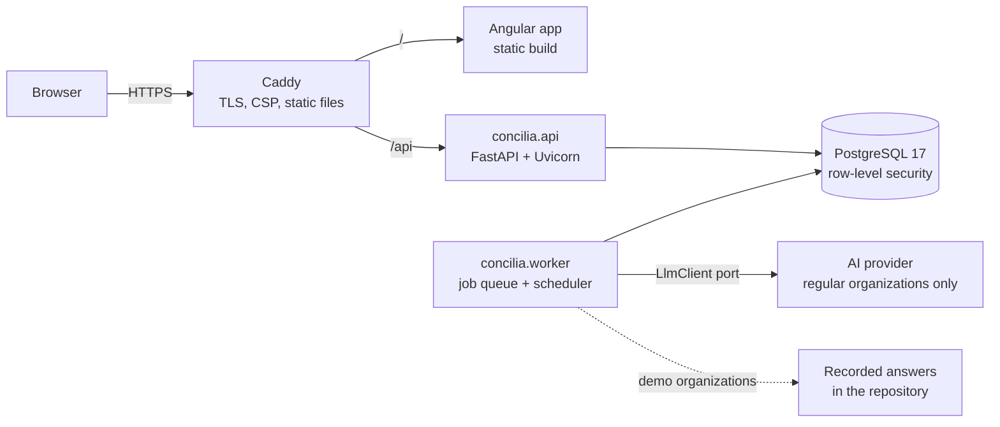

# Concilia

A bank reconciliation backoffice. It matches the credits on a company's bank statement against the receivables it expects to collect, and shows what is reconciled, what is missing, what is duplicated and what does not add up. An analyst confirms each match and a different reviewer approves it, and every decision lands in a history that cannot be edited. An AI assistant suggests matches for the hard cases, but it never decides.

It is a portfolio project: a complete, tested system built the way business software is built, not a demo of one library. The product specification ([docs/SPEC.md](docs/SPEC.md)) and the backlog ([docs/BACKLOG.md](docs/BACKLOG.md)) are in Spanish, like the interface. The decision records, architecture rules and this README are in English.

**Live demo:** <https://concilia-demo.duckdns.org/demo>. Each visit creates a separate organization with fictitious data, which is deleted after four hours.

## What it shows

| Area | In Concilia |
| --- | --- |
| Modern Angular | Angular 22 without zone.js: standalone components, signals for screen state, native control flow, typed reactive forms, RxJS only for real streams (HTTP, job polling). Material tables with server-side keyset pagination, accessible charts, an API client generated from OpenAPI |
| Backoffice systems | Roles, maker-checker approval (four eyes), month close, an audit log, multi-tenancy isolated by the database, background jobs, Excel reports |
| Applied AI with control | Structured output validated on the server, amounts recomputed by the server, every suggestion accepted or rejected by a person with a trace. The system works the same with the AI turned off |

## The monthly cycle

1. An admin registers a bank account and its import profiles, and invites an analyst and a reviewer.
2. The analyst imports the month's statement and receivables (CSV or XLSX), always through a preview.
3. The analyst runs the matching engine, which proposes matches with a rule, a score and an explanation.
4. The analyst confirms or discards, reconciles the rest by hand, and asks the AI about credits with no proposal.
5. A different reviewer approves or rejects, and closes the month.
6. The panel shows the reconciled share, pending credits by age and differences by reason; the month exports to Excel.

## Architecture



- **One modular monolith, two processes.** The API and the worker share one code base and one database. Background work never runs inside the API: the API only enqueues jobs (imports, engine runs, AI suggestions, Excel exports) in a PostgreSQL table, and the worker runs them in three separate transactions so that a crash never duplicates a result.
- **Ordered modules.** `shared.kernel` → `shared.infrastructure` → `audit` → `identity` → `banking` → `periods` → `imports` → `matching` → `ai` → `reporting` → `demo`. Each module has `domain`, `application`, `infrastructure` and `api` layers. A module imports only earlier modules, and only through their `application` layer. When an earlier module needs to know something from a later one, it defines a port that the later module implements.
- **The engine is a pure function.** The same credits and receivables always give the same proposals, in the same order, with the same scores and explanations. It never touches the database or the AI.
- **The database enforces the rules too.** Every organization table has row-level security with `FORCE`, and the application roles own nothing and cannot bypass it. History tables are insert-only for every application role. Triggers re-check four eyes, state transitions, closed months and balances.

The rules above are not just conventions: each one has an automated check that fails the build ([docs/ARCHITECTURE_RULES.md](docs/ARCHITECTURE_RULES.md)).

## Guarantees and how they are verified

| Guarantee | Verified by |
| --- | --- |
| No data crosses organizations, through the API, SQL or views | A two-organization test for every endpoint, and a catalog test that compares every table, view, grant and function with a declarative file |
| Nobody approves or rejects what they created or confirmed | Domain tests and a direct test of the database trigger |
| The engine never uses a credit twice nor exceeds a receivable's balance | Hypothesis property tests and examples per rule |
| Money is integer cents; time comes from an injected clock | AST rules over the whole backend, and tests with a fake clock across month ends and leap years |
| Every POST is idempotent on a client-generated uuid v7, and every job can rerun safely | Replay tests per endpoint, and a rerun test per job kind enforced by a meta-test |
| Concurrent decisions never leave a negative balance or two incompatible decisions | Concurrency tests with real PostgreSQL |
| AI output never decides | Tests with a fake client: invalid output, invented candidates, amounts over balance, bursts against the daily limits |
| Imports and exports are safe | Size, row and content limits, no formula evaluation, `defusedxml`, and formula-injection neutralization in Excel |
| Accessibility (WCAG 2.1 AA) and security headers | Playwright with axe on every screen, and checks of the headers, cookies and Content Security Policy against the running app |

On the demo dataset, rules 1 to 3 propose the right receivables for 75.0 % of the credits that pay any, and the whole engine for 94.6 %, with no wrong proposal. Full figures: [docs/ENGINE_METRICS.md](docs/ENGINE_METRICS.md).

## Decisions

| ADR | Decision |
| --- | --- |
| [0001](docs/adr/0001-modular-monolith.md) | Modular monolith with ordered modules and ports |
| [0002](docs/adr/0002-multi-tenancy-with-rls.md) | Multi-tenancy with PostgreSQL row-level security |
| [0003](docs/adr/0003-append-only-history.md) | Append-only history, `seq` ordering and computed state |
| [0004](docs/adr/0004-files-in-postgresql.md) | Uploaded files and exports stored in PostgreSQL |
| [0005](docs/adr/0005-job-queue-in-postgresql.md) | Job queue and scheduler in PostgreSQL |
| [0006](docs/adr/0006-ai-provider-and-llm-port.md) | AI provider, `LlmClient` port and usage limits |
| [0007](docs/adr/0007-frontend-angular.md) | Angular 22, zoneless, with a generated API client |
| [0008](docs/adr/0008-sessions-csrf-local-https.md) | Cookie sessions, signed double-submit CSRF and local HTTPS |
| [0009](docs/adr/0009-client-ids-and-idempotent-posts.md) | Client-generated ids and idempotent POST requests |
| [0010](docs/adr/0010-deployment.md) | One server with Compose; images built by CI and pulled on deploy |
| [0011](docs/adr/0011-ledger-visual-design.md) | A ledger look on Angular Material 3, with a dark mode |

## Stack

Python 3.14, FastAPI, SQLAlchemy 2 (async, asyncpg), Alembic, Pydantic v2, PostgreSQL 17, structlog, openpyxl, rapidfuzz, the OpenAI SDK behind a port; uv, Ruff, Mypy (strict), Pytest, Hypothesis, Testcontainers, import-linter. Angular 22 with Angular Material, ECharts, ng-openapi-gen, ESLint, Vitest, Playwright and axe. Docker Compose, Caddy and GitHub Actions.

## Run it locally

Requires Docker with Compose and GNU Make.

```sh
make up        # builds and starts PostgreSQL, migrations, API, worker and Caddy
```

Open <https://localhost> and press **Probar la demo**, or open <https://localhost/demo>. Each visit creates a separate demo organization with fictitious data:
- two months already imported, the first one reconciled, approved and closed;
- one user per role, switched with **Ver como**;
- a guided tour;
- the files of a third month to import.

Caddy serves the app over HTTPS with its own local certificate authority, so `__Host-` cookies and the Content Security Policy behave as in production. **One-time step:** after the first `make up`, run `make trust-ca` to add that authority to your OS trust store (`certutil` on Windows, `security` on macOS, `update-ca-certificates` on Debian-based Linux). Until then everything works, but the browser shows a certificate warning.

To create a real organization and its first admin (open registration is off by default):

```sh
make create-org NAME="Comercial Andina" EMAIL=ana@example.com DISPLAY_NAME="Ana Torres"
```

It asks for the admin password and runs as the database owner role, like migrations. Scripts can pass the password on standard input instead:

```sh
printf '%s\n' "$PASSWORD" | docker compose run -T --rm migrator python -m concilia.cli create-org \
  --name "Comercial Andina" --email ana@example.com --display-name "Ana Torres" --password-stdin
```

Deploying to a server: [docs/DEPLOY.md](docs/DEPLOY.md).

`make down` stops everything and keeps the data. Local passwords have development defaults in `docker-compose.yml`; a real deployment must override them (`POSTGRES_PASSWORD`, `CONCILIA_OWNER_PASSWORD`, `CONCILIA_APP_PASSWORD`, `CONCILIA_WORKER_PASSWORD`, `CONCILIA_BACKUP_PASSWORD`).

### The AI assistant

The assistant is on locally (`CONCILIA_AI_ENABLED`). Without a key, nothing leaves your machine:
- regular organizations see the assistant as unavailable;
- demo organizations replay answers recorded in the repository, and never call a provider.

To use the provider of [ADR-0006](docs/adr/0006-ai-provider-and-llm-port.md) in regular organizations, set `OPENAI_API_KEY` before `make up`. Only the fields listed in SPEC are sent: the credit's date, amount and description, and for each candidate its alias, document, customer, balance and dates. Requests are limited to 50 per organization and day, plus a global daily limit (`CONCILIA_AI_GLOBAL_DAILY_LIMIT`).

`make record-ai` refreshes the demo recordings with your key. It loads a demo as a regular organization and asks about every credit of its second month: about 120 small calls.

## Development

Prerequisites: [uv](https://docs.astral.sh/uv/) (it installs Python 3.14), Node.js at the version in [`.nvmrc`](.nvmrc) (for example with [fnm](https://github.com/Schniz/fnm)), and GNU Make.

```sh
cd web && npm ci && cd ..
make lint      # Ruff, Mypy, import-linter, ESLint and TypeScript
make test      # Pytest (unit, integration with Testcontainers, architecture rules) and Vitest
make openapi   # regenerate backend/openapi.json and the Angular API client
```

End-to-end tests (Playwright and axe) run against the stack started with `make up`. Create an organization first, then pass its admin's credentials:

```sh
cd web && npx playwright install chromium && cd ..
E2E_EMAIL=ana@example.com E2E_PASSWORD='…' make e2e
```

They check accessibility, the security headers and cookies, and fail on any Content Security Policy violation.

`e2e/full-flow.spec.ts` walks the whole monthly cycle with two demo users: an analyst imports the third month, runs the engine, confirms and asks the AI; a reviewer approves, reads the panel, exports to Excel and checks the audit log. `cd web && npm run e2e:video` records that story slowly, at 1280×800, under `web/test-results/`, as raw material for a walkthrough video.

## Declared limits

- Concilia does not connect to banks or accounting systems; it works with the CSV and Excel files you upload.
- Only Peruvian soles (PEN) in this version.
- The included bank templates (BCP, Interbank, BBVA) are examples and must be checked against a real statement.
- The AI can be wrong, which is why it never decides.
- A receivable paid in parts across different months is reconciled by hand.

## License

[MIT](LICENSE)
